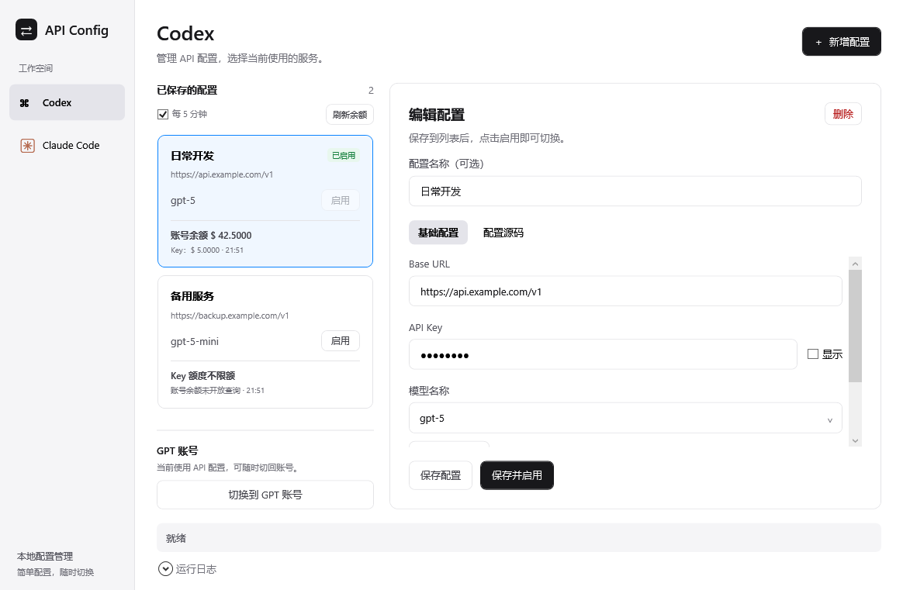
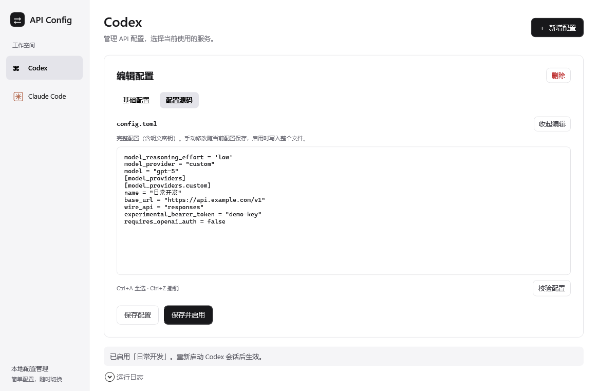

# API 配置工具（Codex / Claude Code）

用于管理 Codex 和 Claude Code 第三方 API 的轻量工具，提供 Windows 图形界面和 macOS / Linux 交互式脚本。



## Windows 图形版

界面参考 CC Switch 的侧栏、配置卡片和启用状态设计。Codex 和 Claude Code 均可保存多套 API 配置，并分别选择一套启用；编辑区保留 Base URL、API Key、模型名称，仅增加可选的配置名称。两边都支持完整配置源码预览与手动编辑。

- 新增、编辑、删除配置；未填写名称时使用接口域名。
- **保存配置**只更新当前应用的本地配置列表；**启用**才写入配置文件，也可使用**保存并启用**。
- 启用状态按实际配置文件核对，外部修改后重新回到窗口会刷新状态。
- 首次打开时读取本机 API 配置，兼容旧版工具的 API / GPT 备份；也可以手动从本机导入。
- 在不同配置或应用之间查看时暂存未保存的表单与源码（包括尚未修正的语法错误），关闭窗口前提示尚未保存的修改。
- 支持获取模型列表后点击模型输入框展开选择，也可手动输入模型；密钥默认隐藏。
- 保留 GPT 账号切换，优先使用当前登录信息，避免用旧备份覆盖已经刷新的令牌。
- **配置源码**可直接编辑 Codex TOML 或 Claude JSON，支持校验、撤销和展开编辑。
- **New API 余额**显示在配置卡片中，工具运行时每 5 分钟自动刷新，也可手动刷新。

从 GitHub Release 下载 Windows 压缩包或单文件 `ApiConfigTool.exe`，解压后运行。选择 Codex 或 Claude Code，新增配置并填写三项参数，点击“保存并启用”；以后可直接点击配置卡片上的“启用”。配置修改后请重新启动对应应用的会话。

每张配置卡片的“启用”旁都有“删除”按钮，确认后即可删除，包括正在启用的配置，无需先切换。删除仅移除工具中的配置记录，已写入本机的 Codex / Claude Code 配置仍会保留。Codex 未登录的用户需使用 Codex 自带的登录流程。

### New API 余额查询

支持复用已保存配置中的 Base URL 和 API Key 查询 New API 额度，无需再填写账号密码或管理令牌。Codex 和 Claude Code 的全部已保存配置都会参与查询（包括未启用的配置），相同站点和 Key 合并查询。

- 打开工具后查询一次，运行期间每 5 分钟刷新。列表上方“刷新余额”可手动刷新；取消“每 5 分钟”可暂停本次运行的自动刷新。关闭程序后停止查询，不安装后台服务或系统计划任务。
- **账号余额**：New API 站点需支持 `user_quota` 返回值，且该 Key 开启“允许查询用户额度”（Allow querying user quota）。可以在 New API 的令牌 / API Keys 编辑页面开启；工具不会代为修改服务端权限。
- **Key 余额**：接口未返回账号额度时，只显示 Key 的剩余额度，并注明“账号余额未开放查询”。Key 不限额并不代表账号余额无限。
- 金额使用站点 `/api/status` 返回的 `quota_per_unit` 及币种 / 汇率换算，支持 USD、CNY、自定义币种。获取不到有效换算参数时显示原始额度，不猜测美元金额。
- 鼠标悬停在余额区域，可查看账号 / Key 已用额度、Key 到期时间、更新时间及错误原因。
- 网络失败保留上次成功结果并标注更新失败。首次失败不会显示为零余额；未支持 New API 接口、Key 无效或权限不足时显示对应状态，自动重试间隔放宽至 30 分钟。
- 同时最多发起 3 个查询。重复手动刷新间隔至少 10 秒；遇到 HTTP 429 时遵守服务器的 `Retry-After`，手动刷新也不会绕过等待时间。

查询地址从配置地址推导，例如 `https://example.com/v1` 对应 `https://example.com/api/usage/token/`；`https://example.com/gateway/v1` 保留反向代理前缀，查询 `/gateway/api/usage/token/`。仅支持该标准接口；自定义转发路径、旧版本或其他供应商可能不支持。API Key 只放在请求的 Authorization 头中，不放进 URL、日志或公共状态请求，也不跟随重定向。

当前验证依据及接口字段见 [New API 源码核对记录](docs/new-api-balance.md)。回归测试使用模拟 HTTP 响应与临时配置，不会调用真实 Key；实际账号余额还取决于站点版本、Key 权限及 IP 白名单。

### 配置预览与手动编辑

1. 选择已有配置或新增配置，点击编辑区的“配置源码”。
2. Codex 显示 `config.toml`，Claude Code 显示 `settings.json`。可以直接修改文本，点击“展开编辑”扩大编辑区。
3. 点击“校验配置”检查语法和必需字段。语法错误会阻止保存及启用，原文件保持不变。
4. 返回“基础配置”时，源码中的地址、密钥、模型会同步到表单。再修改基础字段时，额外的自定义字段会保留。
5. 点击“保存配置”保存当前条目，或“保存并启用”立即写入。

只打开预览不会固定配置快照，也不会写入文件。**手动修改过的源码或显式导入的配置，会作为该条目的完整配置保存；启用时写入整个文件，包括额外字段及字段删除。** 因此，每套配置可以保存不同的 permissions、features 等设置；外部更新了这些设置后，可从本机重新导入。没有手动源码的基础配置在启用时更新地址、密钥、模型等相关字段，并保留本机其他设置。

源码包含明文 API Key。Codex 的账号登录仍由 `auth.json` 管理，源码编辑器不编辑账号令牌；`requires_openai_auth` 在启用时按当前登录状态更新。配置库记录的名称会同步到 `model_providers.custom.name`。



### Claude Code 多配置

Claude Code 使用独立的配置列表，支持新增、编辑、删除、导入、保存和启用。首次打开时自动识别本机已有 API 配置。支持 `CLAUDE_CONFIG_DIR` 自定义配置目录，接口的自定义路径保持原样。

基础配置写入 `env.ANTHROPIC_BASE_URL`、`env.ANTHROPIC_AUTH_TOKEN` 和顶层 `model`，保留其他设置，并清理冲突的旧 `ANTHROPIC_API_KEY`。源码编辑也支持使用 `ANTHROPIC_API_KEY`，两种认证字段只保留一种。无效 JSON、重复字段或不正确的 `env` 类型会被拦截；配置文件和配置库写入失败时执行回滚。

### Codex 写入方式

实现对照 CC Switch 源码提交 `a6f0101b9b25600651ebd95008594107603f712a`，重点参考：

- `src-tauri/src/live/project/codex.rs`：第三方配置统一写到 `model_providers.custom`，密钥放在 provider 表的 `experimental_bearer_token`。
- `src-tauri/src/services/provider/codex_login.rs`：第三方 API 凭据与官方账号登录信息分开处理。
- `src-tauri/src/codex_config.rs` 的 `write_codex_live_atomic`：先校验，再替换文件，后续写入失败时回滚。

生成的配置示例（无官方登录时）：

```toml
model_provider = "custom"
model = "your-model"

[model_providers.custom]
name = "日常开发"
base_url = "https://api.example.com/v1"
wire_api = "responses"
experimental_bearer_token = "your-api-key"
requires_openai_auth = false
```

`auth.json` 保留官方账号登录，旧的 `OPENAI_API_KEY` / `auth_mode = "apikey"` 会在启用 API 时清理；检测到现存账号令牌时，`requires_openai_auth` 设为 `true`。这采用参考项目当前的凭据写法，不再只向 `auth.json` 写第三方 API Key。

基础配置切换时保留 MCP、项目信任、features 等共享设置，移除冲突的旧路由字段；手动源码配置使用该条目保存的完整内容。保留名 `openai`、`ollama`、`lmstudio` 下的旧自定义 provider 表迁移到不冲突的名称，并更新对应 Codex profile 引用。TOML 使用解析器更新，保留配置语义与注释，排版可能被规范化。

若 Codex 默认 `profile` 覆盖了目标服务或模型，会提示冲突并停止写入，避免界面显示切换成功而 Codex 实际仍使用其他配置。

写入前检查 TOML / JSON，文件格式错误时停止操作。每个文件通过同目录临时文件替换；认证、配置或配置库后续写入失败时恢复此前已修改的文件。此机制处理运行时写入异常，不代表多个文件在断电时具有完整事务保证。

Windows 版使用的文件：

| 用途 | 默认位置 |
| --- | --- |
| Codex 配置 | `%USERPROFILE%\.codex\config.toml` |
| 官方账号认证 | `%USERPROFILE%\.codex\auth.json` |
| 多配置列表、旧配置及账号备份 | `%USERPROFILE%\.codex\apiconfig_state.json` |
| 写入互斥锁 | `%USERPROFILE%\.codex\.apiconfig.lock` |
| Claude Code 配置 | `%USERPROFILE%\.claude\settings.json` |
| Claude Code 多配置列表和源码 | `%USERPROFILE%\.claude\apiconfig_claude_state.json` |
| Claude Code 写入互斥锁 | `%USERPROFILE%\.claude\.apiconfig-claude.lock` |

Codex 支持 `CODEX_HOME`，Claude Code 支持 `CLAUDE_CONFIG_DIR` 自定义目录。API Key 会保存在本地配置库和启用的配置文件中，不会显示在配置卡片或运行日志中。Codex 基础表单中接口只有域名时自动补 `/v1`，已有 `/api/coding/v3` 等自定义路径保持原样；源码编辑保留用户明确指定的路径。

## macOS / Linux 终端脚本

```sh
chmod +x api-config-tool.sh
./api-config-tool.sh
# 或直接进入配置流程
./api-config-tool.sh --codex
./api-config-tool.sh --claude
```

终端脚本是独立的单配置流程，需要 Python 3.8+ 或 Node.js 16+。Python 模式可以获取模型列表；Node.js 模式手动输入模型。多配置卡片管理及上面的新 Codex 写入实现适用于 Windows 图形版。

脚本更新已有配置前创建带时间戳的备份，支持 `CODEX_HOME` 和 `CLAUDE_CONFIG_DIR`，默认分别为 `~/.codex` 和 `~/.claude`。

## 本地构建与验证

需要 Windows 和 .NET 9 SDK（或可构建 .NET 9 项目的更新 SDK）：

```powershell
dotnet restore
dotnet build -c Release
dotnet run --project Tests/ApiConfigTool.Tests.csproj -c Release
```

回归检查使用独立临时目录，不读取或改写真实 Codex / Claude Code 配置。覆盖两套应用的多配置保存/启用、旧配置迁移、GPT 令牌保留、源码与表单双向同步、语法校验、独立草稿、损坏文件、写入失败回滚、余额接口解析与调度和 WPF 界面交互。界面预览输出到 `artifacts/ui/`（截图中的余额为模拟值）。

## 发布 Windows 单文件程序

```powershell
dotnet publish ApiConfigTool.csproj -c Release -r win-x64 --self-contained true `
  -p:PublishSingleFile=true `
  -p:IncludeNativeLibrariesForSelfExtract=true `
  -o publish
```

输出：`publish/ApiConfigTool.exe`。

推送到 `main` 后，GitHub Actions 先运行回归检查，再自动递增补丁版本并创建 Release，发布 Windows 压缩包、Windows 单文件程序和 macOS / Linux 脚本。
