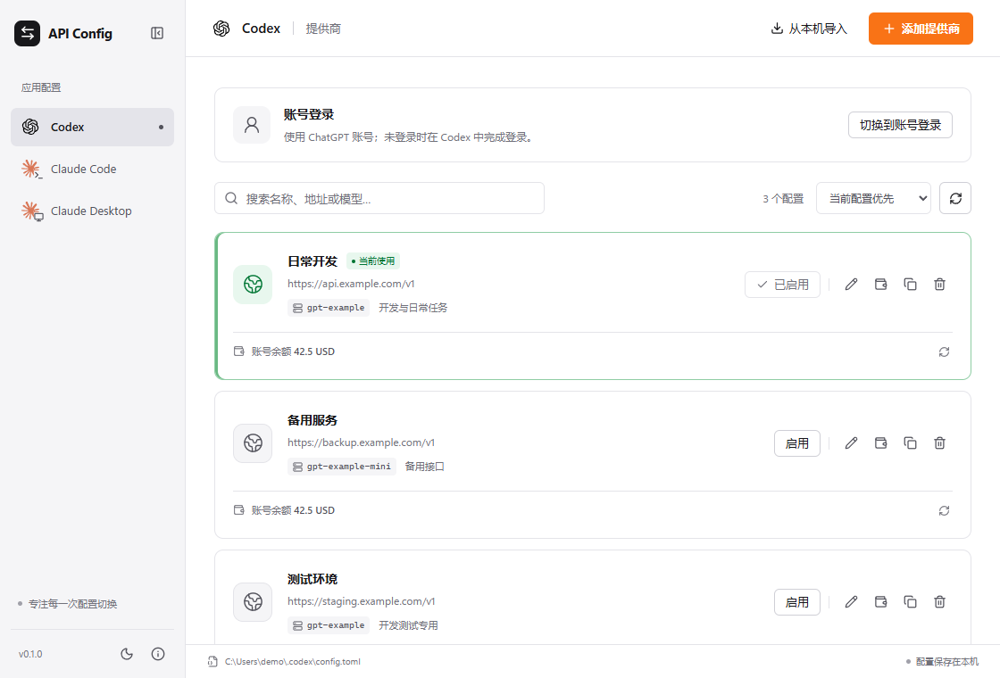
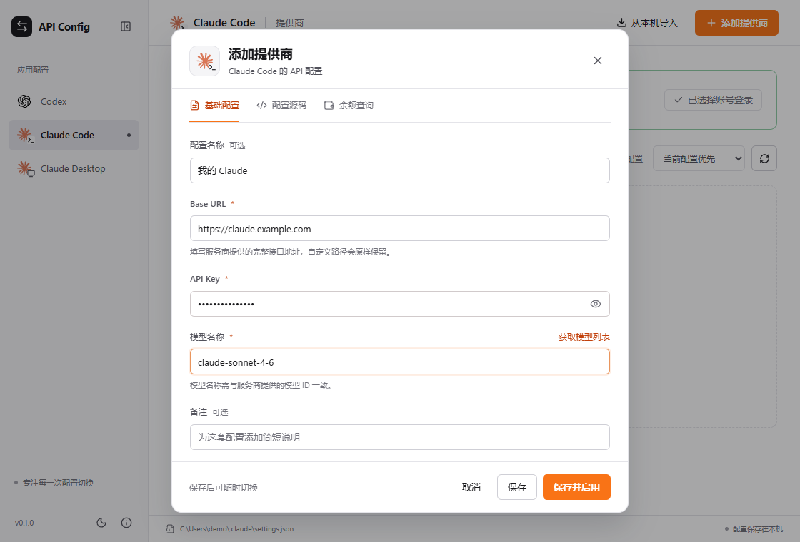

# API Config Tool

基于 [CC Switch](https://github.com/farion1231/cc-switch) 的界面组件和直连配置逻辑裁剪，专注 **Codex、Claude Code、Claude Desktop** 的 API 配置与账号登录方式切换。

使用 **Tauri 2 + React + TypeScript + Rust**。侧栏只有三个应用，主页面是提供商卡片；添加、编辑配置使用弹窗。



## 功能

- 三个应用各自管理多套自定义提供商：新增、编辑、复制、删除、搜索、启用。
- 基础配置：名称、Base URL、API Key、模型、备注。没有内置商业提供商或推荐服务。
- **保存**只更新本地配置库；**启用**才写入应用配置；也可**保存并启用**。
- 三个应用均可切换为官方账号登录，保留已有登录凭据和 API 配置列表；再次启用配置即可切回 API。
- 从本机导入，获取模型列表，编辑 TOML / JSON 源码，浅色 / 深色主题。
- 添加配置后默认查询 New API 账号余额 / Key 额度；支持 CC Switch 格式的自定义余额脚本、测试查询、刷新间隔与关闭查询。
- 当前使用状态按本机实际文件核对，窗口重新获得焦点时刷新。
- 兼容旧版工具的 Codex / Claude Code 多配置列表，保留旧文件。
- 写入前校验和备份；替换失败时恢复本次已修改文件；外部修改冲突时停止写入。

新版不包含 Skills、提示词、会话管理、MCP 管理、代理服务、本地路由、模型映射、多账号托管或请求用量统计。这些模块也未作为后台依赖加载。应用配置里已有的其他设置在基础配置切换时保留。

## 使用

运行 `ApiConfigTool.exe`，选择应用，点击“添加提供商”，填写服务商给出的完整地址、密钥和模型。点击“保存并启用”后重启对应应用或会话。



- Base URL 的路径原样保留，请按服务商要求填写 `/v1` 等路径。
- API Key 默认隐藏，不出现在卡片、搜索结果或错误日志中。密钥会写入本地配置库、应用配置及备份文件。
- 删除只删除工具中的条目，保留已经写入应用的配置。
- 源码编辑必须通过校验；手动源码作为完整配置保存和启用，其中的额外字段与删除操作会生效。
- 切换后不需要工具持续运行。没有常驻 API 转发服务。

### 切换账号登录

点击页面上方的“切换到账号登录”，重启对应应用。已有账号继续由应用管理；尚未登录时，在 Codex 中使用 ChatGPT 登录，在 Claude Code 中运行 `/login`，或在 Claude Desktop 登录 Claude 账号。“已选择账号登录”只表示配置方式，不表示已经完成登录或验证账号。

- Codex 清理第三方连接与模型覆盖，保留 `auth.json` 中当前登录令牌。默认 profile 的非连接设置继续保留。
- Claude Code 清理 API 地址、密钥、模型覆盖及第三方协议选择，使用 `claudeai` 登录方式，保留 `.credentials.json`、系统凭据和已有官方 OAuth token。
- Claude Desktop 切回 `1p`，移除工具的 gateway 配置引用；其他配置项和账号数据保留。
- 切换前会备份，并与配置库一起提交；后续写入失败时回滚。API 配置列表保留，点击条目的“启用”即可切回。

切换针对本文列出的用户配置文件；终端环境变量、项目配置或启动参数若另外指定 API，需要在相应位置调整。

### Claude Desktop

使用 CC Switch 的 **3P gateway 直连配置方式**，写入 `Claude-3p/configLibrary` 并切换 `deploymentMode`，与 Claude Code 的 `settings.json` 分开。

需要支持第三方 gateway 配置的 Claude Desktop 版本，以及兼容 Anthropic 协议的服务端。模型可留空以使用服务端模型发现；手动指定时必须是 Desktop 接受的 Claude 模型 ID，例如 `claude-sonnet-4-6`。本工具不转换协议、不映射模型，因此不能将任意 OpenAI 模型直接配置成 Claude Desktop 的模型。是否能实际请求还取决于服务商与已安装 Desktop 版本。

使用独立的 Desktop profile ID，保留已有 CC Switch 和其他 Desktop 配置项。

### 余额查询

配置卡片默认使用该配置的 API Key 查询 New API `GET /api/usage/token/`。优先显示账号余额，站点未返回 `user_quota` 时仅显示 Key 额度，并提示账号查询未开放；Key 不限额不代表账号余额无限。金额按站点公开的 `/api/status` 参数换算，无法取得参数时显示原始额度。

点击卡片的钱包图标，或编辑器的“余额查询”页，可选择自动查询、自定义脚本或关闭。默认在配置显示后查询，每 5 分钟刷新；间隔可设为 0–1440 分钟，0 表示仅手动查询。查询相同地址、密钥与查询设置时共享缓存；手动刷新至少间隔 10 秒，HTTP 429 按 Retry-After 延后。失败保留上次结果，并明确标为更新失败。

自定义模式支持 CC Switch 的 `({ request: {...}, extractor: function(response) {...} })` 格式、GET / POST、请求头、JSON 或字符串请求体，以及 `{{baseUrl}}`、`{{apiKey}}`、`{{accessToken}}`、`{{userId}}` 占位符。查询 Base URL / API Key 留空时使用基础配置；也可填写独立的面板 Access Token 和 User ID。内置通用模板与 New API 账号模板，点击“测试余额查询”可在保存前检查结果。提取器返回对象或数组，每项包含 `remaining`、`used`、`total` 中至少一个数值，可附 `unit`、`planName`、`extra`；失败可返回 `isValid: false`。详情与示例见 [余额查询说明](docs/balance-query.md)。

余额设置仅保存在工具配置库，不写入 Codex / Claude 配置。查询凭据与 API Key 一样以明文保存在本机配置库及备份中。脚本运行于独立 QuickJS 环境，无文件、进程或系统凭据访问；每次执行最多 2 秒、16 MiB 内存。HTTP 请求不跟随重定向，不共享 Cookie，不回显远端错误正文。

### 下载 macOS 版本

GitHub Releases 同时提供 Windows x64、macOS Apple Silicon（`macos-arm64`）和 Intel（`macos-x64`）。Mac 用户可下载 DMG 拖动安装，也可下载包含 `.app`、文档和许可的 ZIP；最低系统版本为 macOS 11。

当前 macOS 构建未使用 Apple Developer ID 签名或公证，首次打开可能需要在“系统设置 → 隐私与安全性”允许打开。

### 配置文件

| 应用 | 默认配置位置 |
| --- | --- |
| Codex | `~/.codex/config.toml`，支持 `CODEX_HOME` |
| Claude Code | `~/.claude/settings.json`，支持 `CLAUDE_CONFIG_DIR` |
| Claude Desktop / Windows | `%LOCALAPPDATA%/Claude/claude_desktop_config.json`、`%LOCALAPPDATA%/Claude-3p/claude_desktop_config.json`、`Claude-3p/configLibrary/` |
| Claude Desktop / macOS | `~/Library/Application Support/Claude/`、`Claude-3p/` |
| Claude Desktop / Linux | `$XDG_CONFIG_HOME/Claude/`、`Claude-3p/`，默认 `~/.config/` |
| 工具配置库 | `~/.api-config-tool/{codex,claude,claude-desktop}.json` |
| 修改前备份 | `~/.api-config-tool/backups/<操作 ID>/`，`manifest.json` 记录原路径 |

`API_CONFIG_TOOL_HOME` 可自定义工具配置库目录。旧版 `apiconfig_state.json` / `apiconfig_claude_state.json` 在对应新版配置库尚不存在时读取，首次保存后写入新版配置库；旧版文件不改动。

Codex 按 CC Switch 的方式向 `model_providers.custom.experimental_bearer_token` 写入第三方密钥，官方登录令牌保留在 `auth.json`。存在默认 profile 冲突时停止启用并提示修复。

每个文件以同目录临时文件替换；运行时多文件失败会回滚，并留下修改前备份。该机制不保证断电时的跨文件事务。

## 开发和构建

需要 Node.js 22.12+、Rust stable；Windows 需要 C++ Build Tools 和 WebView2 Runtime。macOS 需要 Xcode Command Line Tools；其他依赖见 [Tauri 系统依赖](https://v2.tauri.app/start/prerequisites/)。发布流水线在 Windows、macOS ARM 与 Intel runner 上分别测试和构建，全部成功后创建统一版本的 Release。

```powershell
npm ci
npm run dev             # 桌面程序
npm run dev:renderer    # 浏览器界面预览，不读写本机配置
npm run build           # Windows 可执行文件，无安装包
npm run tauri -- build --bundles app,dmg  # 在 macOS 上生成 .app 与 DMG
```

也可运行 `build-exe.bat`，输出 `publish/ApiConfigTool.exe` 和开源许可文件。Windows 版使用系统 WebView2，自动发布流程使用 Tauri 构建。

```powershell
npm run typecheck
npm test
npm run test:backend
npm run test:e2e
npm run test:native      # Windows 发布构建后，验证真实 EXE 与 WebView2
```

Rust 测试使用临时目录，覆盖三种应用的真实文件结构、保存 / 切换、旧配置导入、源码、错误保护、备份与回滚。Playwright 使用模拟的 Tauri IPC 验证界面交互，截图输出 `artifacts/ui/`，不使用真实密钥。Windows 本地默认使用 Edge；CI 安装 Chromium。原生检查通过独立子进程的环境覆盖，将三种应用的写入目标和 WebView2 数据全部隔离到临时目录，验证真实 EXE 的配置切换和关闭提醒。真实服务商 API 和已安装客户端的联网效果需在本机启用后验证。

## 上游来源

上游来源、固定提交、裁剪范围见 [CC Switch 来源记录](docs/cc-switch-upstream.md)。复用部分保留 [CC Switch MIT 许可](licenses/CC-Switch-MIT.txt)。自定义余额脚本依赖的 [QuickJS](licenses/QuickJS-MIT.txt) 与 [RQuickJS](licenses/RQuickJS-MIT.txt) 许可随发布包提供。
